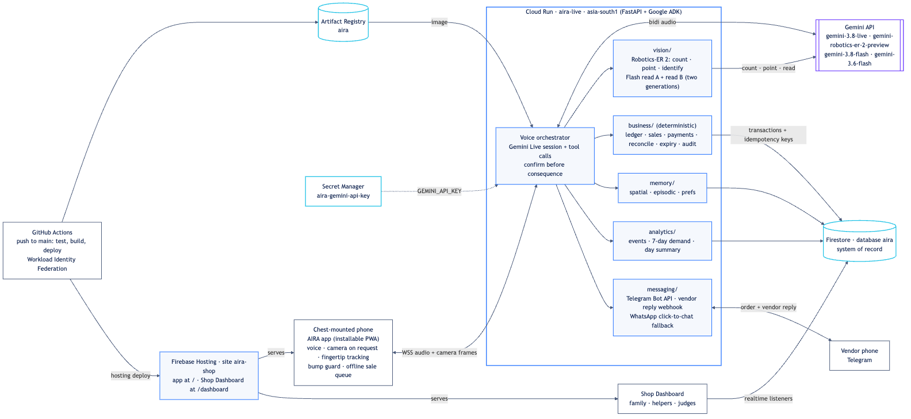

<p align="center"></p>

<h1 align="center">AIRA</h1>
<p align="center"><b>AIRA turns a blind person into a business owner: running a shop, serving customers, ordering stock and earning revenue, all by voice from one phone.</b><br>
Google Cloud AI Builder Cup 2026 · Team Techjays · Theme: Sustainability &amp; Social Impact (Accessibility)<br>
🥇 1st place, Google Cloud Build with AI: Code for Communities · 🥈 2nd place, India AI Impact Summit Buildathon by HCL GUVI (both national level, India)</p>

| | |
|---|---|
| **Live app** (PWA, no install) | https://aira-shop.web.app |
| **Owner dashboard** | https://aira-shop.web.app/dashboard/ |
| **Downloads** (Android app) | https://aira-shop.web.app/download/ |
| **Demo shop** | AIRA Cricket Store, a cricket gear shop |

**AIRA is not an assistant. It makes a blind person an entrepreneur.** Most technology for blind people helps them get through the day. AIRA is built to let them earn. The person is the owner: they take the customer's order, quote the price, collect the cash, give change, reorder from suppliers and check deliveries. AIRA is their eyes and their back office. The result is revenue, not charity: a blind person who runs a business and depends on no one.

It runs in the phone's browser, sees through the camera, talks in whatever language the owner speaks (Tamil, English, Hindi or any other, switching when they switch), and runs the shop by voice. The owner keeps their dignity and their independence; the business keeps a correct stock book and a correct cash box.

## Get AIRA

- **Android:** download the app from the [AIRA downloads page](https://aira-shop.web.app/download/) (Android 7.0 or newer, about 2 MB), open `AIRA.apk` and install it. Updates load automatically, so it never needs a reinstall.
- **iPhone or any phone:** open [aira-shop.web.app](https://aira-shop.web.app) in the browser and add it to the home screen. Nothing to install.
- Tap **Start** once and allow the microphone and camera. After that, AIRA starts listening as soon as it opens, and "Hey Google, open AIRA" or "Hey Siri, open AIRA" opens it by voice.

## The problem

Millions of blind people are able and willing to work, yet many end up depending on family, pensions or charity. Running a small shop is one of the most common ways to make a living in India, but it needs eyes for a long list of small jobs: knowing what a customer is holding up, reading a price or a supplier bill, counting cash and giving change, knowing what is in stock, ordering from suppliers, and moving around the shop without walking into a crate. Today each of those jobs needs a sighted helper, which costs money the shop does not have, or the person stays out of business. AIRA removes that barrier: one phone, one earphone, no hardware to buy and nothing to install.

## Not another AI companion

AI companions for blind people describe the world and keep the person company. AIRA is built for work and income:

| AI companion | AIRA |
|---|---|
| Describes what is around you | Runs a business with you: sales, cash, stock, suppliers, deliveries |
| The user is someone being helped | The user is the owner who makes every decision |
| Success is a good conversation | Success is revenue: sales made, stock that never runs out, cash that adds up |
| Answers can be approximate | Money and stock are computed in code, read twice and confirmed by voice before anything changes |
| Lives in a chat | Connected to the real business: a Firestore stock book and ledger, supplier orders on Telegram and WhatsApp, an owner dashboard |

## What AIRA does

**Seeing for the person**
- Describe what is in front of the camera, read text and labels, identify a product, and answer open questions ("what is this?", "is my way clear?"). Answers are facts from the newest frame, never a guess: when the view is bad or the confidence is low, AIRA says it is not sure and tells the person how to aim the phone.
- "Read this" is read twice by two different models and spoken only when both reads agree.
- A **bump guard** runs on the phone itself (MediaPipe object detector, no network): vibration, a warning tone and "Stop" before the person walks into a chair, a person or a crate. The server can raise an alert's urgency; it can never silence one.
- AIRA never describes or identifies people and never says a currency note is real or fake.

**Walking guidance ("walk with me")**
- A walk gets its own navigation-only Gemini Live session that keeps watching the camera while the person and AIRA talk. Every two seconds the backend asks it for a structured report; **code** decides what to say: one instruction at a time, stops on a hazard, "I can't see the path clearly, please stop" when the view is unusable, and an honest stop when observations stop for 10 s.
- With a shop map (`shared/catalog/*_map.json`) the walk gives step-by-step routes ("Go ahead 8 steps. Turn right. The counter is in front of you") using the phone's own step counter; the step counts in the map are the owner's, counted by hand.
- Urgent stops are never suppressed. No line ever says the way is "clear" or "safe", gives metres, or confirms arrival: "The counter appears to be just ahead. Reach forward carefully to confirm." This is not a replacement for a white cane.

**Remembering where things are**
- Gemini Live silently reports what it sees; AIRA keeps a last-seen memory per conversation. "Where did I put my glasses?" gets "I last saw your glasses on the table, about two minutes ago", never "they are there". In memory only, nothing is written to Firestore.

**Low light**
- When the phone reports sustained darkness, AIRA offers the flashlight and turns it on only after a spoken "yes"; the owner can also say "torch on / off". If the phone has no controllable flash, AIRA says so once.
- "Where is the light switch?" guides the finger to a switch on the board with tones; code picks the switch and never one that overlaps or sits next to a socket. If it cannot tell a switch from a socket, it says so and stops.

**Running the shop by voice**
- Catalog: add, update or disable a product, add stock, add a supplier, ask prices ("how much is a bat?"), stock and expiry, a day summary and reorder suggestions.
- Billing: start a sale, add items, read the total back, wait for a spoken "yes". Cash is read twice by two models and totalled in code; change is computed in code. UPI is confirmed from the shop's payment soundbox announcement, parsed in code and matched to the amount. A customer's payment screenshot is never trusted.
- Supplier orders: read back, confirmed, then sent on **Telegram** (bot) or **WhatsApp** (Cloud API, with a click-to-chat link as fallback); the vendor's reply is spoken to the owner.
- Deliveries: an order is not a delivery. The supplier invoice is read twice by two different models and compared in code with the order and the count; disagreements become a spoken discrepancy, not a ledger entry.
- Every stock, money and state change is a Firestore transaction with an idempotency key: a retried tool call never deducts stock twice.

**Owner dashboard** (Firebase Hosting, read-only Firestore listeners)
- Overview · Today · Stock · Prices · Orders & deliveries · **Live**: the people using AIRA right now, the followed person's camera (WebRTC with a JPEG fallback), the conversation as it happens, and a **Listen** button that plays the person's microphone and AIRA's voice.

**Hands-free**
- "Hey Google, open AIRA" (Android) and "Hey Siri, open AIRA" (iPhone, via a Shortcut) open the app by voice. The play/pause button on wired or Bluetooth earphones talks or stops (Media Session API; built and on in production, not yet verified on a phone). Details: [shared/docs/ops/handsfree.md](shared/docs/ops/handsfree.md).

## Architecture



The process flow (order, delivery, sale) is in [shared/docs/diagrams/process-flow.png](shared/docs/diagrams/process-flow.png); the full write-up is [shared/docs/architecture.md](shared/docs/architecture.md).

- **Gemini Live API** (`gemini-3.8-live`): the voice. Bidirectional audio, the phone's 1 fps camera as realtime video, function calling for every shop action, and silent tool calls (`nav_report`, `scene_report`) that feed walking guidance and scene memory without being spoken.
- **Gemini Flash**: `gemini-3.8-flash` for the first read of invoices and cash, Google Search grounding (`web_search`) and the map photo descriptions; `gemini-3.6-flash` for the independent second read, a different model generation so the two reads do not fail the same way. `gemini-embedding-2` for Firestore vector search over products and the last-seen memory. The `point` and `count` roles default to `gemini-robotics-er-2-preview` with a Flash fallback. Model IDs live only in `backend/aira_live/models.py`.
- **Cloud Run** (`aira-live`, `asia-south1`): FastAPI with WebSockets (`/ws` for phones, `/monitor` for the dashboard). Holds the Live session, runs the tools, the business engine, messaging, webhooks and jobs; the only writer to Firestore.
- **Firestore** (database `aira`): products, suppliers, orders, deliveries, inventory, ledger, sales, payments, audit logs, events, vector indexes.
- **Firebase Hosting** (site `aira-shop`): the phone app at `/` and the dashboard at `/dashboard/`.
- **Secret Manager**: the Gemini API key, the shared app key, the job token and the messaging secrets, mounted as env vars.
- **GitHub Actions**: tests on every PR; on `main`, build the image, push to Artifact Registry, deploy Cloud Run and Hosting with keyless Workload Identity Federation.
- **On the phone**: MediaPipe EfficientDet-Lite0 (bump guard, in a Web Worker) and MediaPipe Hand Landmarker (fingertip tracking for hand guidance).

**The model proposes, the backend commits.** Gemini never writes stock, money or state. Every tool returns structured facts; anything that changes money or stock goes through `confirm.propose` and runs only after a spoken "yes". Totals, change, stock and state transitions are computed in code; a spoken number that did not come from a tool result is caught by `aira_live/safety.py`.

## Safety and honesty principles

- **Never invents counts, prices, amounts or paths.** A number must come from a tool result; "unsure" results are said as unsure with an aim hint.
- **Two reads must agree** for invoices, cash and "read this"; otherwise "not sure, let me look again".
- **Confirm before consequence.** Ordering, paying, completing a sale, turning on the torch: all wait for a spoken "yes".
- **Evidence before state.** An order is not a delivery; an invoice is not proof of receipt; a saved location is a hint ("I last saw"), not a fact.
- **Urgent warnings are never suppressed.** The phone's bump guard needs no server; walk stops cut through AIRA's own speech.
- **Honest about limits.** No depth, no distances, no "safe" or "clear"; arrival is never confirmed; the guidance says so when it goes blind. AIRA is not a replacement for a white cane or a guide dog.
- **No people, no counterfeit claims.** Never describes or identifies people; cash reading is help, not a fake-note check.
- **External data is data.** Search results and vendor messages can never trigger a tool or a confirmation.

## Repository layout

```
backend/                 aira-live on Cloud Run (Python 3.12, FastAPI, Gemini Live)
  aira_live/             session, live bridge, tools, vision, business engine, messaging, monitor, walk, memory
  tests/                 pytest suite (offline, fakes; tests/live_real is opt-in)
frontend/                npm workspace root
  app/                   AIRA phone app (Vite + TypeScript + Preact, installable PWA, MediaPipe on device)
  dashboard/             Owner dashboard (Vite + TypeScript + Preact, Firestore realtime, Live page)
shared/contracts/        WebSocket protocol + Firestore types + fixtures (npm package used by both apps)
shared/catalog/          demo catalog, shop maps and their JSON schemas
shared/scripts/          seed_firestore.py, build_hosting.sh, bench_table.py, describe_shop_photos.py, ...
shared/infra/            firebase.json, Firestore rules and indexes, GCP bootstrap, keyless deploy setup
shared/bench/            benchmark scorers and data formats (results are not committed)
shared/docs/             architecture.md · ops/ · diagrams/ · proposals/
shared/assets/logo/      AIRA logo
shared/.env.example      template for the local .env
.github/workflows/       ci.yml (pull requests) · deploy.yml (push to main)
```

## Run it locally

You need Node 20+, Python 3.12 and [uv](https://docs.astral.sh/uv/).

```bash
# 1. Settings. With GEMINI_API_KEY empty (or AIRA_MOCK=1) the backend runs in mock mode: no cloud calls.
cp shared/.env.example .env

# 2. Backend on http://localhost:8080 (WebSocket at ws://localhost:8080/ws, health at /health)
cd backend
uv sync
uv run uvicorn aira_live.main:app --reload --port 8080 --env-file ../.env

# 3. Phone app (new terminal). npm runs inside frontend/, the workspace root.
#    The app connects to ws://localhost:8080/ws by default.
cd frontend
npm ci
npm run dev -w app

# 4. Optional: dashboard. Set the VITE_FIREBASE_* values, or VITE_USE_EMULATOR=1 with the Firestore emulator.
npm run dev -w dashboard

# 5. Optional: seed the demo shop into Firestore database "aira" (needs GCP_PROJECT and ADC)
uv run --project backend python shared/scripts/seed_firestore.py
```

Feature flags for a local run (walking, routes, torch, low light, scene memory) are listed in `shared/.env.example`.

## Tests

```bash
cd backend && uv sync && uv run pytest -q                      # backend: tools, business engine, vision, walk, protocol
cd frontend && npm ci && npm test && npm run typecheck && npm run build   # app + dashboard (vitest, tsc, vite)
cd shared/contracts && npm ci && npm test && npm run typecheck  # the shared contracts package
```

All default suites run offline with fakes. Real Gemini calls run only in the opt-in suite: `AIRA_LIVE_TESTS=1 GEMINI_API_KEY=... uv run pytest tests/live_real -q` from `backend`.

Benchmark scorers for counting, product identification, cash, invoices and hand guidance live in `shared/bench/` with their data formats. Their results are written to `shared/bench/results/`, which is not committed. We do not quote numbers we have not measured.

## Team

**Techjays**

| Member | Designation | Certifications |
|---|---|---|
| Saravana Rajan B (lead) | Senior AI Engineer | Google Cloud Professional Cloud Architect |
| Ishwarya | Staff AI Engineer | Google Cloud Associate Cloud Engineer |
| Kanish | Senior AI Engineer | Google Cloud Associate Cloud Engineer · Google Cloud Professional Machine Learning Engineer |
| Sarmitha | AI Engineer | Google Cloud Associate Cloud Engineer · Google Cloud Professional Machine Learning Engineer |

### Team achievements

- 🥇 **1st place**, Google Cloud Build with AI: Code for Communities (national level, India)
- 🥈 **2nd place**, India AI Impact Summit Buildathon, conducted by HCL GUVI (national level, India)
