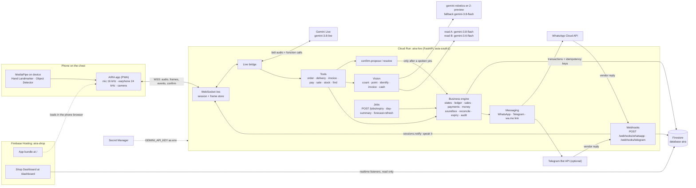
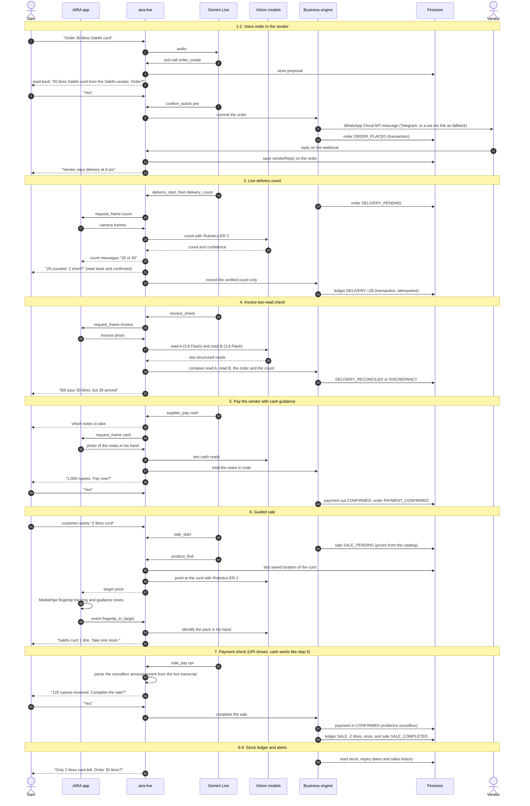
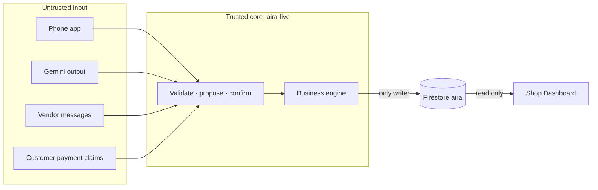

# AIRA architecture

AIRA has three parts:

1. **The phone app** (`frontend/app`). A PWA on a chest-mounted phone. It streams the mic and camera to the backend, plays AIRA's voice in one earphone, and runs MediaPipe on the device.
2. **The backend** (`backend`). `aira-live` is a FastAPI service on Cloud Run in `asia-south1`. It holds the Gemini Live session, runs the tools, and owns every write to Firestore.
3. **The Shop Dashboard** (`frontend/dashboard`). A read-only web page that shows the shop in real time from Firestore.

The app and the dashboard are served from one Firebase Hosting site, `aira-shop`: the app at `/` and the dashboard at `/dashboard`. The backend's WebSocket URL is injected into the app at build time. It is not stored in the repository.

## System diagram



### What runs where

| Where | What | Notes |
|---|---|---|
| Phone | Voice I/O, gestures (double-tap to talk, long-press to stop), earcons, haptics | Works with TalkBack |
| Phone | Camera frames | Sent only when the server asks (`request_frame`) |
| Phone | MediaPipe Hand Landmarker | Tracks the index fingertip. Turns the target point into stereo pan, pitch and beep rate |
| Phone | MediaPipe Object Detector | The **bump guard**. Vibrates and beeps when an obstacle is in the walking path. No network needed |
| Cloud Run | Gemini Live session, tools, vision calls, business engine, messaging, webhooks, jobs | One warm instance (`min=1, max=1`) with session affinity, because the live-session registry is in memory |
| Gemini API | Voice, pointing, counting, reading | Model IDs live only in `backend/aira_live/models.py`. They can be switched by env or the Firestore doc `config/runtime` |
| Firestore | Every record: stock, orders, sales, payments, audit | Written only by `aira-live` |
| Browser | Shop Dashboard | Reads the demo shop in real time. Cannot write |

### Models

| Role | Model | Job |
|---|---|---|
| `live` | `gemini-3.8-live` | Listens, speaks, can be interrupted, calls tools. Answers in the language of the last utterance and switches with the speaker; no default language |
| `point`, `count` | `gemini-robotics-er-2-preview` | Finds a product in the frame, counts packs, checks the pack in his hand |
| fallback for `point`, `count` | `gemini-3.8-flash` | Used when ER 2 is slow or failing |
| `read` | `gemini-3.8-flash` | Invoice and cash: read A |
| `verify` | `gemini-3.6-flash` | Invoice and cash: read B. A different model generation, so the two reads do not fail the same way |

Coordinates are `[y, x]` for a point and `[ymin, xmin, ymax, xmax]` for a box, normalised to 0–1000. All speech comes from Gemini Live. The vision models return structured data only.

### WebSocket protocol

The protocol is defined twice and kept in sync: `shared/contracts/src/messages.ts` (TypeScript) and `backend/aira_live/contracts.py` (pydantic). Shared fixtures in `shared/contracts/fixtures/` are tested on both sides.

- **App → server:** `hello`, `audio` (16 kHz PCM16), `frame` (JPEG with a purpose), `text`, `event`, `confirm`, `stop`.
- **Server → app:** `ready`, `audio` (24 kHz PCM16), `transcript`, `request_frame`, `target`, `count`, `state`, `confirm`, `cue`, `error`.

## Order-to-sale sequence

Sam talks to the app. The app streams his voice over `/ws` to `aira-live`, which streams it to Gemini Live. To keep the diagram short, arrows from Sam go straight to `aira-live`, and arrows back to him are spoken replies.



Notes on the sequence:

- Every step that changes money or stock (order, vendor payment, sale) goes through `confirm.propose(...)`. The commit runs only after a spoken "yes", either through the Live tool `confirm_action` or a `confirm` message from the app.
- Delivery counts and sales write to the **ledger**. `inventory/{sku}.onHand` changes in the same transaction. Each ledger entry carries a unique `idemKey` built from the tool-call ID, so a retried call is a no-op.
- The demand forecast is a 7-day moving average of sale ledger entries. With fewer than 3 days of data, AIRA gives no forecast. Business events are appended to `shops/{shopId}/events` after each commit.
- Expiry and day-summary checks run through `/jobs/*`. The app can call them at startup as a "morning check". They need the `X-AIRA-Job-Token` header. Alerts are spoken in the owner's live session through `sessions.notify`.
- **Bump guard** is not in this diagram. It runs only on the phone, all the time, and never waits for the server.

## Data model

Firestore database `aira`. The demo shop is `shops/sunrise_dairy`. Types are in `shared/contracts/src/firestore.ts`.

```
shops/{shopId}                     name, ownerUid, city, currency "INR", timezone "Asia/Kolkata"
  products/{sku}                   name, brand, unit "L"|"pack"|"jar"|"box", packSizeL?, packSizeG?,
                                   price, costPrice, reorderThreshold, shelfLifeDays, aliases {ta[], hi[], en[]}
  suppliers/{id}                   name, phone, channel "whatsapp"|"telegram"|"call", products[sku]
  orders/{id}                      supplierId, items[{sku, qty, agreedPrice?}], state, channelMsgId?,
                                   vendorReply?, idemKey, createdAt, updatedAt
  deliveries/{id}                  orderId, items[{sku, expectedQty, countedQty, method, confidence}],
                                   invoice{imageUri, readA, readB, agreed, lines[], total},
                                   discrepancies[{sku|field, expected, actual}], state
  inventory/{sku}                  onHand, batches[{batchId, qty, expiryDate}], updatedAt
  ledger/{txnId}                   sku, delta, reason "DELIVERY"|"SALE"|"RETURN"|"ADJUST"|"EXPIRED",
                                   refType, refId, idemKey (unique), at, actor
  locations/{sku}                  zone e.g. "fridge2/middle/left", confirmedBy "user"|"model", confirmedAt, confidence
  sales/{id}                       items[{sku, qty, unitPrice, lineTotal}], total, state, paymentId?, idemKey,
                                   createdAt, completedAt
  payments/{id}                    direction "in"|"out", method "cash"|"upi", amount, state,
                                   evidence{type "cash_count"|"soundbox"|"user_confirm", detail}, refType, refId
  proposals/{id}                   pending confirmations from confirm.propose (kind, prompt, payload, committer)
  memoryEvents/{id}                type, text, refType?, refId?, at
  auditLogs/{id}                   actor "owner"|"aira"|"system", action, refType, refId, outcome, evidenceUri?, at
  events/{autoId}                  topic, payload, ts   (sales, inventory-movements, orders, discrepancies, alerts)
  prefs/main                       speechRate, verbosity, productAliases, supplierAliases
  msgIndex/{id}, contactIndex/{id} server only: map vendor messages and contacts back to orders

idempotency/{idemKey}              result, at   (dedupe for retried tool calls; server only)
config/runtime                     model and feature overrides (pointing_model, count_model, live_model,
                                   whatsapp_enabled); server only
```

Money is in whole rupees. Stock is in each product's selling unit (litres, packs, jars or boxes). `business.catalog` converts spoken amounts, for example "5 kg paneer" becomes 25 packs of 200 g, and AIRA reads both back.

### States

Transitions are checked in code by `business/states.py`. An invalid jump raises an error.

| Entity | States |
|---|---|
| Order | `DRAFT → ORDER_PLACED → DELIVERY_PENDING → DELIVERY_RECONCILED \| DISCREPANCY → PAYMENT_PENDING → PAYMENT_CONFIRMED → CLOSED` |
| Sale | `SALE_PENDING → SALE_COMPLETED \| SALE_VOID` |
| Payment | `PENDING → CONFIRMED \| FAILED` |

## Trust boundaries

The rule across every boundary: **the model proposes, the backend commits**. Nothing that comes from a model, a client or a vendor is stored as fact until code has checked it.



| # | Boundary | What crosses it | How it is controlled |
|---|---|---|---|
| 1 | Phone → `aira-live` (`/ws`) | Audio, frames, events, confirmations | Every message is parsed against the shared contract. Frames have a size limit. Nothing is accepted before `hello`. The demo build has no sign-in, so the server pins the session to the demo shop and the owner role. A `confirm` must match a stored proposal |
| 2 | `aira-live` → phone | Audio, targets, counts, links | The app opens only `https://wa.me/`, `https://api.whatsapp.com/` and `tel:` links |
| 3 | Gemini → `aira-live` | Tool calls, counts, reads, points | Model output is a proposal. Tools validate arguments. Totals, change and stock are computed in code. State changes go through `states.transition`. Spoken numbers are checked against tool results. Two reads must agree, or AIRA says "not sure" and asks for another look |
| 4 | Physical world → records | What the camera sees | Counts need confidence and a read-back. Only the verified quantity enters the ledger. A saved location is a hint, so live pointing checks it again. Cash reading is assistance, never a counterfeit check |
| 5 | Customer → payment | "I paid" | A UPI payment is confirmed only by the soundbox announcement (amount parsed in code, exact match) or the owner's clear confirmation. A payment screenshot is never trusted |
| 6 | Vendors → webhooks | WhatsApp and Telegram replies | The WhatsApp webhook checks Meta's signature with the app secret and a verify token. Replies are stored as text on the order and spoken. A vendor's message never changes stock or money. An order is not a delivery |
| 7 | `aira-live` → Firestore | All writes | Only the `aira-live` service account writes, and its access is limited to database `aira`. Writes run in transactions with idempotency keys. Every action is written to `auditLogs` |
| 8 | Browsers → Firestore | Dashboard reads | Firestore rules allow reads of the demo shop only. All client writes are denied. `idempotency`, `config` and other shops are server only |
| 9 | Jobs → `aira-live` | `/jobs/*` calls | Require the `X-AIRA-Job-Token` header |
| 10 | GitHub → Google Cloud | Deploys | Keyless Workload Identity Federation, limited to `main` of this repository. The deployer account has the minimum roles. No JSON key exists |
| 11 | Secrets | Gemini API key, messaging tokens | Kept in Secret Manager or env. Never in git. Project IDs and service URLs are not in the repository |
| 12 | On the phone | Bump guard | Runs locally with no network. The server may raise an alert's urgency but can never silence it |

## Deploy pipeline

Every push to `main` runs `.github/workflows/deploy.yml`:

1. Test: `npm ci && npm test && npm run typecheck` in `shared/contracts/` and in `frontend/` (the npm workspace root for the app and the dashboard), then `cd backend && uv sync --frozen && uv run pytest -q`.
2. Sign in to Google Cloud with Workload Identity Federation.
3. Build the `aira-live` container image, push it to Artifact Registry (`asia-south1`) and deploy it to Cloud Run with the Gemini key mounted from Secret Manager.
4. Read the new service URL and inject the WebSocket URL into the app build (`VITE_AIRA_LIVE_WS`).
5. Build the app and the dashboard into one bundle (`shared/scripts/build_hosting.sh`) and deploy it to Firebase Hosting site `aira-shop` with `firebase deploy --config shared/infra/firebase.json`.

Pull requests run the same tests through `.github/workflows/ci.yml`, with no access to Google Cloud.
